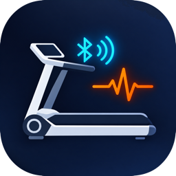

# iConsole+ (ChangYow) for Home Assistant



[](https://github.com/d-lebed/ha-iconsole/actions/workflows/validate.yml)
[](https://my.home-assistant.io/redirect/marketplace_repository/?owner=d-lebed&repository=ha-iconsole&category=integration)
[](https://github.com/d-lebed/ha-iconsole/releases)
[](./LICENSE)
[](https://buymeacoffee.com/lebiadz)

Custom Home Assistant integration for **iConsole+** / **ChangYow** Bluetooth LE treadmills (such as **Zipro**, **Toorx**, **Reebok**, **DKN**, **Focus Fitness**, **JTX**, **Flow Fitness**, and **Sportop**).

---

## Why this integration exists

Many treadmills equipped with **ChangYow (`iConsole+`)** consoles advertise the standard Bluetooth **FTMS (`0x1826`)** service UUID in their BLE advertisement packets, causing standard FTMS integrations to discover them. However, once a GATT connection is established, these consoles **do not expose the FTMS GATT service (`0x1826` / `0x2ACD` / `0x2AD9`)** at all.

Instead, they communicate over ChangYow's proprietary BLE UART service:
- **Primary GATT Service**: `0000fff0-0000-1000-8000-00805f9b34fb` (`0000fff1` Notify, `0000fff2` Write without response)
- **Fallback ISSC Service**: `49535343-fe7d-4ae5-8fa9-9fafd205e455` (`49535343-1e4d-4bd9-ba61-23c647249616` Notify, `49535343-8841-43f4-a8d4-ecbe34729bb3` Write)

This integration implements the proprietary ChangYow `0xF0` binary framing protocol directly on top of Home Assistant's native Bluetooth stack (`bleak` + `bleak-retry-connector`) with **zero external PyPI dependencies**.

For a deep technical dive into the reverse-engineered packet format, opcodes, and console state machine, see **[docs/PROTOCOL.md](./docs/PROTOCOL.md)**. For release history, see **[CHANGELOG.md](./CHANGELOG.md)**.

---

## Supported Hardware Revisions (`00.D2` vs `00.D5`)

ChangYow treadmill consoles report their protocol revision in the Bluetooth Device Information Service (`0x180A` -> Serial Number `0x2A25`) in the format `<ClientID>.<MeterID>` (for example, `00.D2` or `00.D5`).

This integration automatically detects the hardware revision from the serial number and tailors the exposed entities to match the hardware capabilities of the console:

| Feature / Entity | Classic Treadmill (`XX.D2`, e.g. `SI1022`) | Newer D5 Treadmill (`XX.D5`) |
| :--- | :---: | :---: |
| **Live Telemetry Sensors** (Speed, Distance, Calories, Heart Rate, Incline, Elapsed Time, Training Status) | ✅ | ✅ |
| **Diagnostic Connection Status Sensor** (`disconnected`, `connecting`, `sleeping`, `connected`, `autonomous_running`) | ✅ | ✅ |
| **Bluetooth Connection Switch** (disconnect HA to free BLE for mobile apps or handrail keys) | ✅ | ✅ |
| **Stop Workout Button** (`button.stop`) | ✅ | ✅ |
| **Target Inclination** (`number.target_inclination`) | ✅ (`0xAC` Route Incline) | ✅ (`0xA8` D5 Incline) |
| **Start / Pause Workout Buttons** (`button.start_resume`, `button.pause`) | ❌ *(Started from console panel for safety)* | ✅ |
| **Live Target Speed Control** (`number.target_speed`) | ❌ *(Not supported by `00.D2` firmware)* | ✅ (`0xA6` D5 Speed) |

---

## Console Behavior & Important Notes (`00.D2` Treadmills)

1. **Starting a Workout**:
   On `00.D2` treadmills, the ChangYow firmware requires workouts to be started using the **START button on the main console panel** (a hardware safety requirement). Upon connecting and after each stop, the integration automatically sends the unlock sequence (`KeyLock = 1 / UnLock`, `0xAF`) so the main panel buttons are always ready to use.
2. **Handrail Buttons vs. Main Panel Buttons**:
   While any Bluetooth client (Home Assistant, iConsole+, or Kinomap) is actively connected to a `00.D2` console, the treadmill firmware disables the secondary Start/Stop/Speed buttons on the **handrails** and only accepts input from the **main console panel**. If you prefer to run using the handrail buttons without telemetry, turn off the **Bluetooth connection** switch in Home Assistant.
3. **Console Sleep Mode**:
   When the treadmill screen turns off after inactivity, the BLE module remains powered and connected while the main MCU sleeps. The integration detects this automatically, sets the **Connection status** sensor to `sleeping`, and wakes/initializes the console as soon as you press any button on the panel.
4. **Autonomous Run Mode**:
   If a workout is started on the treadmill *before* Bluetooth initialization completes, the console enters autonomous mode and ignores BLE polling until the belt stops. The **Connection status** sensor will report `autonomous_running` and automatically resume telemetry once the belt stops.

---

## Installation

> **Note:** This integration is currently installed as a **Custom Repository** (it is not yet listed in the built-in default catalog). Starting with **Home Assistant 2026.11**, HACS ships built-in as **Settings → Marketplace**.

### Option 1: One-Click via My Home Assistant (Recommended)

Click the button below to open this repository directly in your Home Assistant **Marketplace** (or **HACS** on Home Assistant 2026.10 and older). Since the repository is not yet in the default catalog, Home Assistant will automatically prompt you to add `d-lebed/ha-iconsole` as a custom integration repository first:

[](https://my.home-assistant.io/redirect/marketplace_repository/?owner=d-lebed&repository=ha-iconsole&category=integration)

*(On Home Assistant 2026.10 or older with standalone HACS, you can also use the [legacy HACS redirect link](https://my.home-assistant.io/redirect/hacs_repository/?owner=d-lebed&repository=ha-iconsole&category=integration).)*

### Option 2: Adding as a Custom Repository in Home Assistant Marketplace (2026.11+)

1. In Home Assistant, go to **Settings → Marketplace** (or **HACS** on 2026.10 and older).
2. Click the three-dots menu (`⋮`) in the top-right corner and select **Custom repositories**.
3. Paste the repository URL:
   ```text
   https://github.com/d-lebed/ha-iconsole
   ```
4. Select type/category **Integration** and click **Add**.
5. Find **iConsole+ (ChangYow)** in the list and click **Install**.
6. Once installed, your treadmill will be auto-discovered via Bluetooth under **Settings → Devices & Services**, or you can start the setup directly:

   [](https://my.home-assistant.io/redirect/config_flow_start/?domain=iconsole)

### Option 3: Manual Installation

1. Copy the `custom_components/iconsole` folder into your Home Assistant `config/custom_components/` directory.
2. Restart Home Assistant and add **iConsole+ (ChangYow)** under **Settings → Devices & Services → Add Integration**.

---

## Credits & Acknowledgments

This integration was made possible thanks to the reverse-engineering efforts and open-source work of the community:

- **[Nickwasused/iconsoleplus-app-diff](https://github.com/Nickwasused/iconsoleplus-app-diff)** — Community protocol analysis and command structure documentation for `00.D2` and `00.D5` hardware revisions.
- **[cagnulein/qdomyos-zwift (QZ)](https://github.com/cagnulein/qdomyos-zwift)** by Roberto Viola (`src/devices/trxappgateusbtreadmill/trxappgateusbtreadmill.cpp`, [Issue #32](https://github.com/cagnulein/qdomyos-zwift/issues/32), [Issue #2223](https://github.com/cagnulein/qdomyos-zwift/issues/2223)) — Extensive BLE packet captures and initialization sequences for Toorx / iConsole+ / DKN / Kinomap treadmills.
- **[dudanov/hassio-ftms](https://github.com/dudanov/hassio-ftms)** by M. Dudanov — Inspiration for the Home Assistant entity structure and Bluetooth coordinator architecture.
- **[haraldh/iconsole](https://github.com/haraldh/iconsole)** & **[haraldh/iconsole-android](https://github.com/haraldh/iconsole-android)** — Early reverse-engineering of the ChangYow serial/Bluetooth protocol.

---

## Disclaimer & Legal Notice

> **⚠️ USE AT YOUR OWN RISK — SAFETY & LIABILITY DISCLAIMER**
>
> Motorized treadmills and fitness equipment are heavy mechanical devices capable of causing serious personal injury or property damage.
>
> - This software is an **independent, community-maintained open-source project** created strictly for personal interoperability purposes. It is **not** affiliated with, endorsed by, sponsored by, or supported by Chang Yow Technologies, iConsole+, Zipro, Toorx, Reebok, DKN, Kinomap, or any other fitness equipment manufacturer. All product and company names are trademarks™ or registered® trademarks of their respective holders; their use here is solely for identification and compatibility description.
> - **Always attach the physical safety tether/key** to your clothing before stepping onto a treadmill, never leave a powered treadmill unattended, and never trigger remote commands while anyone (including children or pets) is near the belt without their knowledge.
> - In accordance with Sections 7 and 8 of the [Apache License, Version 2.0](./LICENSE), this software is provided **"AS IS"**, **without warranties or conditions of any kind**, and the authors or copyright holders shall **not be liable for any direct, indirect, incidental, special, or consequential damages, personal injury, or equipment malfunction** arising from the use of this integration.

---

## License

This project is licensed under the [Apache License, Version 2.0](./LICENSE).

